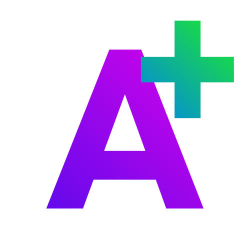
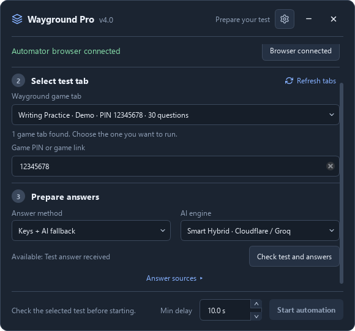
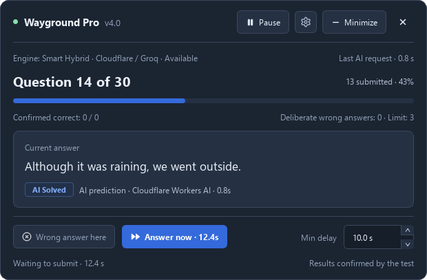

<p align="center">
  
</p>

<h1 align="center">Wayground Pro Automator</h1>

<p align="center">
  Desktop automation for Wayground with verified answer keys and optional AI solving.
  <br><br>
  <a href="https://github.com/whyred2/wayground-pro-automator/releases/latest">
    
  </a>
  <br><br>
  <b>English</b> · <a href="README.ru.md">Русский</a>
</p>

## Download and run

1. Download the build for your platform from [GitHub Releases](https://github.com/whyred2/wayground-pro-automator/releases/latest).
2. Open the Windows `.exe`, extract and run the Linux executable, or extract the macOS `.app` for Intel or Apple Silicon.
3. Have **Microsoft Edge, Google Chrome or Chromium** installed. Packaged builds do not require a separate Python installation; the built-in AI gateway needs no personal API key.

Linux and macOS support is **experimental**. Linux builds target Ubuntu 24.04; macOS builds are not notarized. See [platform setup and limitations](docs/platform-support.md) for launch instructions.

## Quick start

1. Click **Connect browser**, sign in and join the test in the Automator browser.
2. Click **Refresh tabs**, select the game tab and enter its PIN or link if needed.
3. Choose **Verified answer keys only** (default), **Keys + AI fallback**, or **AI only**.
4. For key-based modes, click **Check test and answers** and review the source and question counts. **AI only** can start directly after an engine availability check.
5. Set **Min delay** and click **Start automation**. The default minimum is 10 seconds; **0** skips automatic waiting.
6. Use the live panel to pause, resume or submit one answer with **Answer now**. **Stop automation** in Settings leaves the browser open.

Written questions without a fixed key wait for your own response in the test tab. Missing or ambiguous answers remain unsubmitted. The desktop interface is in English.

## Preview

| Startup | Live panel |
| --- | --- |
|  |  |

Screenshots use demonstration data. [See the compact strip and light/dark Settings](docs/usage.md#screenshots).

## Features

- **Verified keys:** Wayground API lookup, checked public-library matches and optional answer sources. Repeated questions keep separate records.
- **Optional AI:** Smart Hybrid gateway, Groq presets or a personal OpenAI-compatible API. Engines are checked before use; AI predictions are labeled separately from verified keys.
- **Live controls:** Compact strip, pause/resume, **Answer now**, adjustable timing and deliberate-mistake limits.
- **Desktop settings:** Light/dark themes, always-on-top, verified-option highlighting and Boss key. Shortcut behavior varies by platform.
- **Selected-game binding:** Closing the target tab, reloading its active game page or changing games requires fresh preparation.

To connect your own API, open **Settings → AI engine → Personal API** and check the URL, key and model. UI-entered credentials last until the app closes; use [`.env` configuration](docs/usage.md#personal-api) to retain them across restarts.

## Run from source

Requires **Python 3.10+** and an installed supported browser. From the repository root, in Windows PowerShell:

```powershell
python -m venv .venv
.venv/Scripts/Activate.ps1
python -m pip install -r requirements.txt
python src/main.py
```

For Linux/macOS, use the [platform-specific setup](docs/platform-support.md#running-from-source). The console menu is available with `python src/main.py --cli`; see the [CLI reference](docs/usage.md#cli-parameters) for other modes and flags.

## Documentation

| Topic | Link |
| --- | --- |
| Desktop workflow, API settings, CLI, screenshots and troubleshooting | [User guide](docs/usage.md) · [На русском](docs/usage.ru.md) |
| Downloads, system requirements, profiles and platform limitations | [Platform support](docs/platform-support.md) |
| Project structure, tests and native builds | [Development](docs/development.md) |
| Release notes and version history | [v4.1](docs/releases/v4.1.md) · [v4.0](docs/releases/v4.0.md) · [Changelog](CHANGELOG.md) |
| Contributions and gateway deployment | [Contributing](CONTRIBUTING.md) · [AI gateway](cloudflare-worker/README.md) |

## Disclaimer

For educational and research purposes only. The developers are not responsible for misuse or violations of third-party platform terms.

[License](LICENSE)
