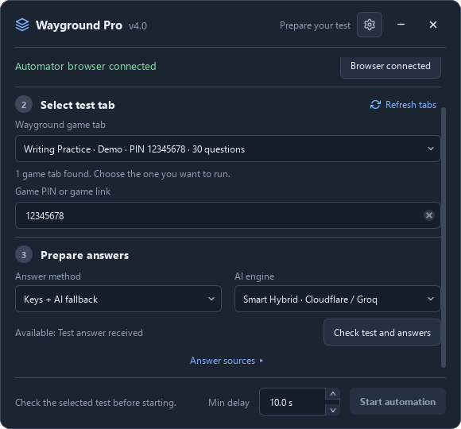
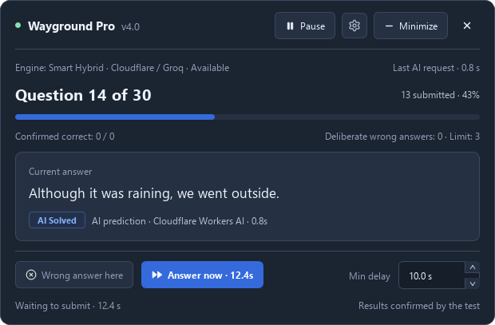

<p align="center">
  
</p>

<h1 align="center">Wayground Pro Automator</h1>

<p align="center">
  Автоматизация Wayground с проверенными ключами ответов и поддержкой ИИ.
  <br><br>
  <a href="https://github.com/whyred2/wayground-pro-automator/releases/latest">
    
  </a>
  <br><br>
  <a href="README.md">English</a> · <b>Русский</b>
</p>

## Установка

1. Скачайте сборку для своей платформы со страницы [GitHub Releases](https://github.com/whyred2/wayground-pro-automator/releases/latest).
2. Откройте `.exe` в Windows, распакуйте и запустите исполняемый файл в Linux или распакуйте `.app` для Intel либо Apple Silicon в macOS.
3. Нужен установленный **Microsoft Edge, Google Chrome или Chromium**. Готовым сборкам не требуется отдельная установка Python; встроенный ИИ-шлюз работает без личного API-ключа.

Поддержка Linux и macOS — **экспериментальная**. Linux-сборки рассчитаны на Ubuntu 24.04; macOS-сборки не нотарифицированы. Порядок запуска и ограничения описаны в [документации платформ](docs/platform-support.md).

## Быстрый старт

1. Нажмите **Connect browser**, войдите в аккаунт и откройте тест в браузере Automator.
2. Нажмите **Refresh tabs**, выберите игровую вкладку и при необходимости укажите её PIN или ссылку.
3. Выберите **Verified answer keys only** (по умолчанию), **Keys + AI fallback** или **AI only**.
4. Для режимов с ключами нажмите **Check test and answers**, проверьте источник и количество вопросов. **AI only** может стартовать сразу после проверки доступности движка.
5. Установите **Min delay** и нажмите **Start automation**. Минимум по умолчанию — 10 секунд; **0** отключает автоматическое ожидание.
6. Через пульт можно поставить паузу, продолжить или отправить один ответ кнопкой **Answer now**. **Stop automation** в Settings оставляет браузер открытым.

Письменные вопросы без фиксированного ключа ожидают вашего ответа во вкладке теста. Вопросы без полного и однозначного ответа остаются неотправленными. Интерфейс приложения на английском.

## Интерфейс

| Стартовое окно | Пульт |
| --- | --- |
|  |  |

На скриншотах демонстрационные данные. [Компактная полоска и светлая/тёмная тема Settings](docs/usage.ru.md#скриншоты).

## Возможности

- **Проверенные ключи:** API Wayground, проверка совпадений в публичной библиотеке и дополнительные источники. Повторяющиеся вопросы хранятся отдельно.
- **ИИ по выбору:** шлюз Smart Hybrid, предустановки Groq или личный OpenAI-совместимый API. Движки проверяются перед использованием; предположения ИИ помечаются отдельно от ключей.
- **Управление во время работы:** компактная полоска, пауза, **Answer now**, настройка задержки и лимита намеренных ошибок.
- **Настройки интерфейса:** светлая/тёмная тема, закрепление поверх окон, подсветка подтверждённых вариантов и Boss key. Работа горячих клавиш зависит от платформы.
- **Привязка к выбранной игре:** закрытие вкладки, перезагрузка активной страницы или смена игры требуют новой подготовки.

Свой API настраивается в **Settings → AI engine → Personal API**: укажите и проверьте URL, ключ и модель. Ввод через UI действует до закрытия приложения; для сохранения между запусками используйте [`.env`](docs/usage.ru.md#личный-api).

## Запуск из исходников

Нужны **Python 3.10+** и поддерживаемый браузер. Из корня проекта в Windows PowerShell:

```powershell
python -m venv .venv
.venv/Scripts/Activate.ps1
python -m pip install -r requirements.txt
python src/main.py
```

Для Linux/macOS есть [отдельная инструкция](docs/platform-support.md#running-from-source). Консольное меню открывается командой `python src/main.py --cli`; остальные режимы и флаги описаны в [справочнике CLI](docs/usage.ru.md#параметры-запуска).

## Документация

| Тема | Ссылка |
| --- | --- |
| Оконный режим, API, CLI, скриншоты и устранение проблем | [Руководство](docs/usage.ru.md) · [English](docs/usage.md) |
| Сборки, системные требования, профили и ограничения ОС | [Поддержка платформ](docs/platform-support.md) |
| Структура проекта, тесты и нативные сборки | [Разработка](docs/development.md) |
| Изменения и история версий | [v4.1](docs/releases/v4.1.md) · [v4.0](docs/releases/v4.0.md) · [История](CHANGELOG.md) |
| Участие в проекте и развёртывание шлюза | [Contributing](CONTRIBUTING.md) · [ИИ-шлюз](cloudflare-worker/README.md) |

## Отказ от ответственности

Инструмент предназначен для образовательных и исследовательских целей. Разработчики не несут ответственности за ненадлежащее использование и нарушения правил сторонних платформ.

[Лицензия](LICENSE)
