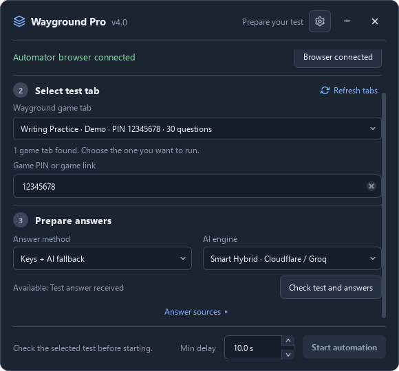
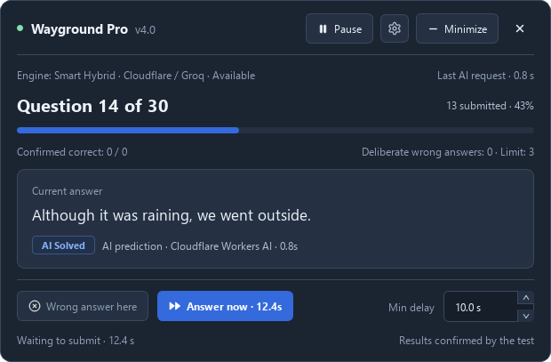
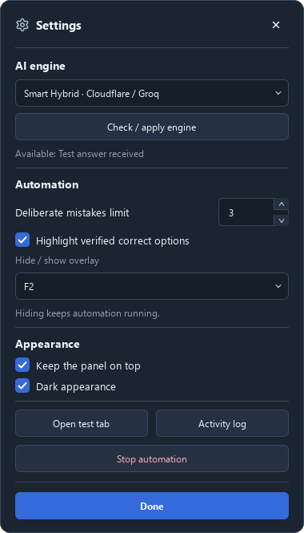
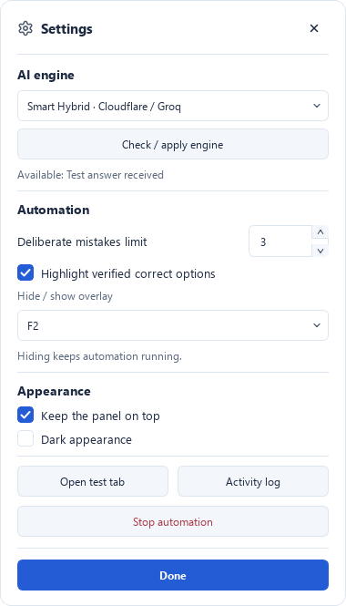

# User guide

[← README](../README.md) · [Русский](usage.ru.md)

[Desktop workflow](#desktop-workflow) · [Personal API](#personal-api) · [CLI parameters](#cli-parameters) · [How it works](#how-it-works) · [Screenshots](#screenshots) · [Troubleshooting](#troubleshooting)

## Desktop workflow

Open the desktop UI:

```powershell
python src/main.py
```

Or open the packaged app for your platform.

**What happens:**

1. Click **Connect browser**, then sign in and join your test in the Automator browser.
2. Click **Refresh tabs** and explicitly select the game tab, including a test already in progress. If needed, fill **Game PIN or game link** with that game's PIN or supported link.
3. Choose **Verified answer keys only** (default), **Keys + AI fallback**, or **AI only**. AI availability is checked with a real test request; written responses without fixed keys remain manual.
4. For key-based modes, click **Check test and answers** and review the source, key/question counts and written responses. **Answer sources** accepts a teacher quiz URL or a separate CheatNetwork tab; Quizit is optional and may require its own sign-in. In **AI only**, you can click **Start automation** directly; the program checks the engine before starting.
5. Set **Min delay** on the startup screen and the deliberate-mistake limit in **Settings**, then click **Start automation**. The delay is a lower bound for variable automatic waiting, not a fixed interval; **0** skips waiting.
6. Use the live panel or **Minimize** strip. **Answer now** while paused submits one answer and preserves pause. On Windows, F2 hides/restores the overlay while execution continues; Linux/macOS shortcut behavior is described in the [platform guide](platform-support.md). **Stop automation** in Settings keeps the browser open.

## Personal API

To use your own OpenAI-compatible API, open **Settings → AI engine → Personal API**, enter **API base URL**, **API key**, and **Model**, then click **Check / apply engine**. The key is masked by default. Successful settings apply to the next AI request during a run; failed checks keep the previous settings. UI-entered API settings last until the app closes and are never saved in UI preferences. For configuration across restarts, use `.env`.

The connection check verifies a real JSON test answer using the same request parameters as the solver. GPT-6 uses `max_completion_tokens` with room for reasoning and omits custom temperature. Explicit API rejections of token-limit parameters or temperature trigger bounded compatibility retries; successful capabilities are reused for that API URL and model until the app closes.

For persistent configuration, copy [`.env.example`](../.env.example) to `.env` and set `OPENAI_API_BASE`, `OPENAI_API_KEY` and `AI_MODEL`. Remove the placeholder `AI_GATEWAY_URL` line to keep the bundled gateway, or replace it with your own gateway URL. Select **Personal API** in Settings to use your provider.

Place `.env` in the project root for source runs, beside the executable on Windows/Linux, or beside `WaygroundAutomator.app` on macOS. See [persistent locations](platform-support.md#persistent-locations) for UI preferences and browser profiles.

## CLI parameters

Run `python src/main.py --cli` to open the console menu. The windowed executable also accepts `--cli` and opens a console for that mode. Supplying automation flags selects the console workflow; `--gui` explicitly opens the desktop UI.

All available CLI options are listed by `python src/main.py --help`:

| Parameter                 | Description                                              | Default                                    |
| ------------------------- | -------------------------------------------------------- | ------------------------------------------ |
| `--cli`                   | Open the console menu instead of the desktop UI          | Desktop UI without arguments               |
| `--gui`                   | Explicitly open the desktop UI                          | Same as no arguments                       |
| `--ai`                    | Use AI solver exclusively (no database lookups)          | `False`                                    |
| `--ai-provider ENGINE`    | Choose `gateway`, `direct`, `groq-120b`, `groq-20b`, or `off`; enabled engines are checked before starting | Interactive selection |
| `--no-ai`                 | Disable AI solver and auto-fallback completely           | `False`                                    |
| `--ai-key KEY`            | Custom API key for AI solver (OpenAI/Groq compatible)    | From `.env` / `OPENAI_API_KEY`             |
| `--ai-model MODEL`        | Custom model for AI solver                               | `qwen/qwen3.8-27b`                         |
| `--ai-base URL`           | Custom OpenAI API base URL                               | `https://api.groq.com/openai/v1`           |
| `--attach`                | Attach to Edge/Chrome (auto-launch if needed)            | `False`                                    |
| `--wrong N`               | Number of intentionally wrong answers                    | `0` (asks interactively if not set)        |
| `-q, --quiz-input STR`    | Game PIN, room hash, quiz ID, or supported URL for answer lookup | `None`                              |
| `--no-bot`                | Disable optional Quizit Standard/Bot fallback             | `False`                                    |
| `--port PORT`             | Browser debug port for attach mode                       | `9222`                                     |
| `--test-url URL`          | URL of the test page (for normal mode)                   | `https://wayground.com`                    |
| `--answers-url URL`       | URL of the answer key page (for fallback)                | `https://cheatnetwork.eu/services/quizizz` |

**Examples:**

```powershell
# Desktop UI (recommended)
python src/main.py

# Console menu
python src/main.py --cli

# Auto-start with AI solver directly
python src/main.py --ai

# Auto-start attach mode with 5 intentionally wrong answers
python src/main.py --attach --wrong 5
```

## How it works

### Phase 1: Retrieving Answer Keys

The program resolves the selected game's PIN or room hash and reads explicit keys from the Wayground Game API. When the server hides keys, it searches the public library and verifies a candidate against the game questions before using its answers. A listener on the selected test tab also captures answer keys supplied by normal browser responses. Keys are stored separately for each question, including repeated wording.

If direct lookup fails, existing CheatNetwork answer tabs are offered as a fallback. Optional Quizit Standard may require sign-in to a Quizit account. CheatNetwork download dialogs are waited out without automatic refreshes; login notices pause for manual sign-in. Existing tabs stay open; only a temporary tab created by the program may be closed after successful retrieval.

### Phase 2: Test Automation

The script reads the screen and matches the prompt.

1. Resolves a complete key for the current question or asks the selected AI engine when the mode permits it. **AI only** skips answer-key lookup.
2. Calculates variable reading time from the chosen minimum and question length (`0.05 seconds/character`), with ±30% variation. The desktop lower bound defaults to 10 seconds; **0** skips automatic waiting. The console keeps its reading-time behavior.
3. Matches and submits single-select, multi-select and supported blank answers. Optional highlighting is limited to verified correct options.
4. In the desktop UI, applies a deliberate mistake when configured and a verified alternative is available. A live limit of zero prevents new mistakes without erasing submitted history; **Answer now** bypasses the remaining countdown. The console retains `--wrong N`.
5. Tracks the game's current question and validates the selected session before submission. Normal navigation within that game is allowed; an active-page reload, closed tab or changed game requires preparation again. Consecutive identical prompts keep separate records.

Missing, ambiguous or incomplete answers leave the question unsubmitted with an explanation. A waiting timeout does not count as completion. The desktop waits for manual submission on unkeyed written questions and resumes afterward. AI predictions do not count as confirmed correctness; accuracy is read from the actual Wayground results.

## Screenshots

These screenshots show the actual desktop windows with demonstration data, not a live account or game session.

| Startup: choose a game and check its answers | Live panel: answer, source and run controls |
| --- | --- |
|  |  |

**Compact strip** — Current question, pause, Settings and Expand remain accessible.


| Settings: dark appearance | Settings: light appearance |
| --- | --- |
|  |  |

## Troubleshooting

### Could not connect on port 9222

The debugging port may be unavailable or a previous Automator browser may still be running. Close the browser window created by Automator and try **Connect browser** again. Browser-profile locations and the `WAYGROUND_BROWSER` override are listed in the [platform guide](platform-support.md).

### Automation stopped at question ...

The question may have no complete key, its options may not match the retrieved answers, or the AI request may have failed. Check the selected test tab, PIN and answer source; check the engine if AI is enabled. Prepare the current test again before restarting. The unresolved question remains unsubmitted.

### Written response or changed game

For an OPEN question without a fixed key, enter and submit your own response in the test tab; the desktop run resumes afterward. Closing the tab, reloading the active game page or switching games requires fresh preparation.
