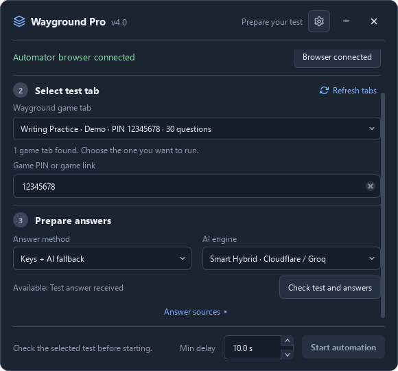
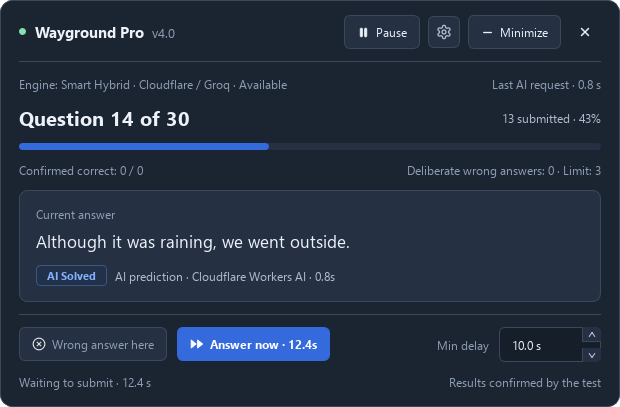
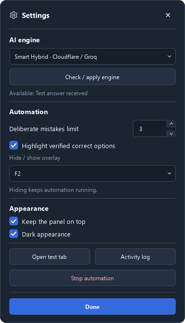
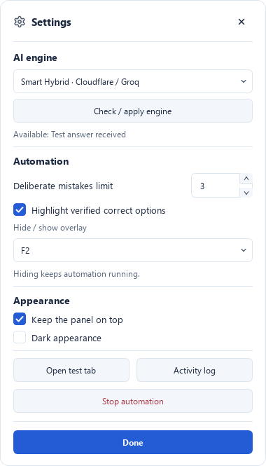

# Руководство пользователя

[← README](../README.ru.md) · [English](usage.md)

[Оконный режим](#оконный-режим) · [Личный API](#личный-api) · [Параметры запуска](#параметры-запуска) · [Как это работает](#как-это-работает) · [Скриншоты](#скриншоты) · [Устранение проблем](#устранение-проблем)

## Оконный режим

Для Linux и macOS доступны [инструкция запуска и ограничения](platform-support.md). В этих системах Boss key работает, пока приложение в фокусе; восстановление доступно через трей или панель задач/Dock.

Откройте оконный интерфейс:

```powershell
python src/main.py
```

Или откройте готовое приложение для своей платформы.

**Что произойдёт:**

1. Нажмите **Connect browser**, войдите в аккаунт и откройте игру в браузере Automator.
2. Нажмите **Refresh tabs** и выберите игровую вкладку, в том числе уже начатый тест. При необходимости укажите его PIN или поддерживаемую ссылку в **Game PIN or game link**.
3. Выберите **Verified answer keys only** (по умолчанию), **Keys + AI fallback** или **AI only**. Доступность ИИ проверяется реальным пробным запросом; письменные ответы без ключа вводятся вручную.
4. В режимах с ключами нажмите **Check test and answers** и проверьте источник, количество ключей/вопросов и письменные вопросы. В **Answer sources** доступны ссылка на тест учителя и отдельная вкладка CheatNetwork; Quizit необязателен и может запросить собственную авторизацию. В **AI only** можно сразу нажать **Start automation** — программа сначала проверит ИИ.
5. Установите **Min delay** на стартовом экране и лимит ошибок в **Settings**, затем **Start automation**. Это нижняя граница переменного ожидания, а не фиксированный интервал; **0** отключает ожидание.
6. Управляйте пультом или полоской **Minimize**. **Answer now** во время паузы отправляет один ответ и сохраняет паузу. В Windows F2 скрывает/возвращает пульт, пока автоматизация продолжается; поведение в Linux/macOS описано в [документации платформ](platform-support.md). **Stop automation** в Settings оставляет браузер открытым.

## Личный API

Для своего OpenAI-совместимого API откройте **Settings → AI engine → Personal API**, заполните **API base URL**, **API key** и **Model**, затем нажмите **Check / apply engine**. Ключ по умолчанию скрыт. Во время работы успешно проверенные параметры применяются к следующему AI-запросу; неудачная проверка сохраняет прежние параметры. Введённые через UI параметры действуют до закрытия приложения и не записываются в настройки интерфейса. Для сохранения между запусками используйте `.env`.

Проверка подключения требует корректный JSON-ответ на тестовый вопрос и использует те же параметры, что и решатель. Для GPT-6 передаётся `max_completion_tokens` с запасом на рассуждения, без пользовательской температуры. При явном отказе API принять параметр лимита токенов или температуры выполняется ограниченный подбор совместимых параметров; успешный результат запоминается для этого URL и модели до закрытия приложения.

Для постоянной конфигурации скопируйте [`.env.example`](../.env.example) в `.env` и задайте `OPENAI_API_BASE`, `OPENAI_API_KEY` и `AI_MODEL`. Удалите строку с шаблонным `AI_GATEWAY_URL`, чтобы сохранить встроенный шлюз, или укажите URL собственного шлюза. Для работы со своим провайдером выберите **Personal API** в Settings.

При запуске из исходников `.env` размещается в корне проекта; для готовой сборки — рядом с исполняемым файлом Windows/Linux или рядом с `WaygroundAutomator.app` в macOS. Каталоги настроек и профиля браузера перечислены в [документации платформ](platform-support.md#persistent-locations).

## Параметры запуска

Консольное меню доступно через `python src/main.py --cli`. Оконная сборка `.exe` также принимает `--cli` и открывает консоль для этого режима. Аргументы автоматизации выбирают консольный режим; `--gui` явно открывает оконный интерфейс.

Полный список аргументов выводится командой `python src/main.py --help`:

| Параметр                 | Описание                                                | По умолчанию                               |
| ------------------------ | ------------------------------------------------------- | ------------------------------------------ |
| `--cli`                  | Открыть консольное меню вместо оконного интерфейса      | Без аргументов открывается UI               |
| `--gui`                  | Явно открыть оконный интерфейс                         | Как при запуске без аргументов              |
| `--ai`                   | Решать тест напрямую через AI Solver (без поиска базы)  | `False`                                    |
| `--ai-provider ENGINE`   | Выбрать `gateway`, `direct`, `groq-120b`, `groq-20b` или `off`; доступность ИИ проверяется перед стартом | Интерактивный выбор |
| `--no-ai`                | Полностью отключить ИИ-солвер и авто-переключение на ИИ | `False`                                    |
| `--ai-key KEY`           | Пользовательский API ключ (Groq / OpenAI)               | Из `.env` / `OPENAI_API_KEY`               |
| `--ai-model MODEL`       | Модель для решения (Groq / OpenAI)                     | `qwen/qwen3.8-27b`                         |
| `--ai-base URL`          | Базовый URL OpenAI-совместимого API                     | `https://api.groq.com/openai/v1`           |
| `--attach`               | Подключиться к Edge/Chrome (автозапуск при нужде)       | `False`                                    |
| `--wrong N`              | Сделать N намеренных ошибок (иначе спросит в меню)      | `0` (запрашивает, если не задано)            |
| `-q, --quiz-input STR`   | PIN игры, хеш комнаты, ID теста или поддерживаемая ссылка | `None`                                  |
| `--no-bot`               | Отключить дополнительный источник Quizit Standard/Bot  | `False`                                    |
| `--port PORT`            | Порт отладки браузера для режима подключения            | `9222`                                     |
| `--test-url URL`         | URL страницы теста                                      | `https://wayground.com`                    |
| `--answers-url URL`      | URL сервиса ответов CheatNetwork (fallback)             | `https://cheatnetwork.eu/services/quizizz` |

**Примеры:**

```powershell
# Запуск напрямую через AI Solver (qwen/qwen3.8-27b)
python src/main.py --ai

# Запуск с 6 специальными ошибками через attach-режим
python src/main.py --attach --wrong 6
```

## Как это работает

### Выгрузка правильных ответов (Phase 1)

Программа определяет PIN или хеш комнаты выбранного теста и получает явные ключи через API игры Wayground. Если сервер скрывает ответы, программа ищет исходный тест в публичной библиотеке и проверяет найденный вариант по вопросам игры. Обработчик сетевых ответов выбранной вкладки также получает ключи, которые сервер передаёт браузеру. Каждый вопрос хранится отдельно, даже если формулировки повторяются.

Если прямой поиск не дал результата, можно выбрать открытую вкладку CheatNetwork. Дополнительный источник Quizit Standard может потребовать входа в отдельный аккаунт Quizit. Окна загрузки CheatNetwork ожидаются без автоматической перезагрузки; сообщения об авторизации приостанавливают работу для ручного входа. Существующие вкладки остаются открытыми; после успешного получения ответов программа может закрыть только созданную ею временную вкладку.

### Решение (Phase 2)

1. Получает полный ключ текущего вопроса или обращается к выбранному ИИ, если режим это разрешает. **AI only** пропускает поиск ключей.
2. Вычисляет переменное время чтения по выбранному минимуму и длине вопроса (`0.05 секунды на символ`) с разбросом ±30%. В оконном режиме минимум по умолчанию равен 10 секундам; **0** отключает автоматическое ожидание. В консоли сохранён расчёт времени чтения.
3. Сопоставляет и отправляет одиночные, множественные и поддерживаемые текстовые ответы. Необязательная подсветка применяется только к подтверждённым правильным вариантам.
4. В оконном режиме выполняет намеренную ошибку, если она настроена и доступен подтверждённый неправильный вариант. Нулевой лимит предотвращает новые ошибки и сохраняет историю уже отправленных; **Answer now** пропускает оставшееся ожидание.
5. Учитывает текущий номер вопроса и проверяет выбранную сессию перед отправкой. Обычные переходы внутри той же игры разрешены; перезагрузка активной страницы, закрытие вкладки и другая игра требуют новой подготовки. Последовательные одинаковые формулировки сохраняют отдельные записи.

Отсутствие полного или однозначного ответа оставляет вопрос неотправленным с объяснением причины. Таймаут не считается завершением теста. Оконный режим ожидает ручной отправки письменного вопроса без ключа и продолжает после неё. Предположение ИИ не считается подтверждённой правильностью; точность считывается из настоящих результатов Wayground.

## Скриншоты

На скриншотах показаны настоящие окна программы с демонстрационными данными, а не действующий аккаунт или сессия теста. Интерфейс на английском.

| Старт: выбор игры и проверка ответов | Пульт: ответ, источник и управление |
| --- | --- |
|  |  |

**Компактная полоска** — Номер вопроса, пауза, Settings и Expand остаются доступными.


| Settings: тёмная тема | Settings: светлая тема |
| --- | --- |
|  |  |

## Устранение проблем

<details>
<summary><b>❌ Could not connect on port 9222</b></summary>

**Причина:** Отладочный порт недоступен или предыдущий браузер профиля Automator ещё работает.
**Решение:** Закройте окно браузера, созданное Automator, и повторите **Connect browser**. Каталоги профиля и настройка `WAYGROUND_BROWSER` описаны в [документации платформ](platform-support.md).

</details>

<details>
<summary><b>❌ Automation stopped at question ...</b></summary>

**Причина:** Нет полного ключа для вопроса, варианты не совпали с найденными ответами либо выбранный ИИ не вернул пригодный результат.
**Решение:** Проверьте выбранную вкладку теста, PIN и источник ответов. При использовании ИИ проверьте его доступность. Загрузите ключи текущего теста и запустите программу снова. Вопрос остаётся неотправленным; случайные ответы не подставляются.

</details>
